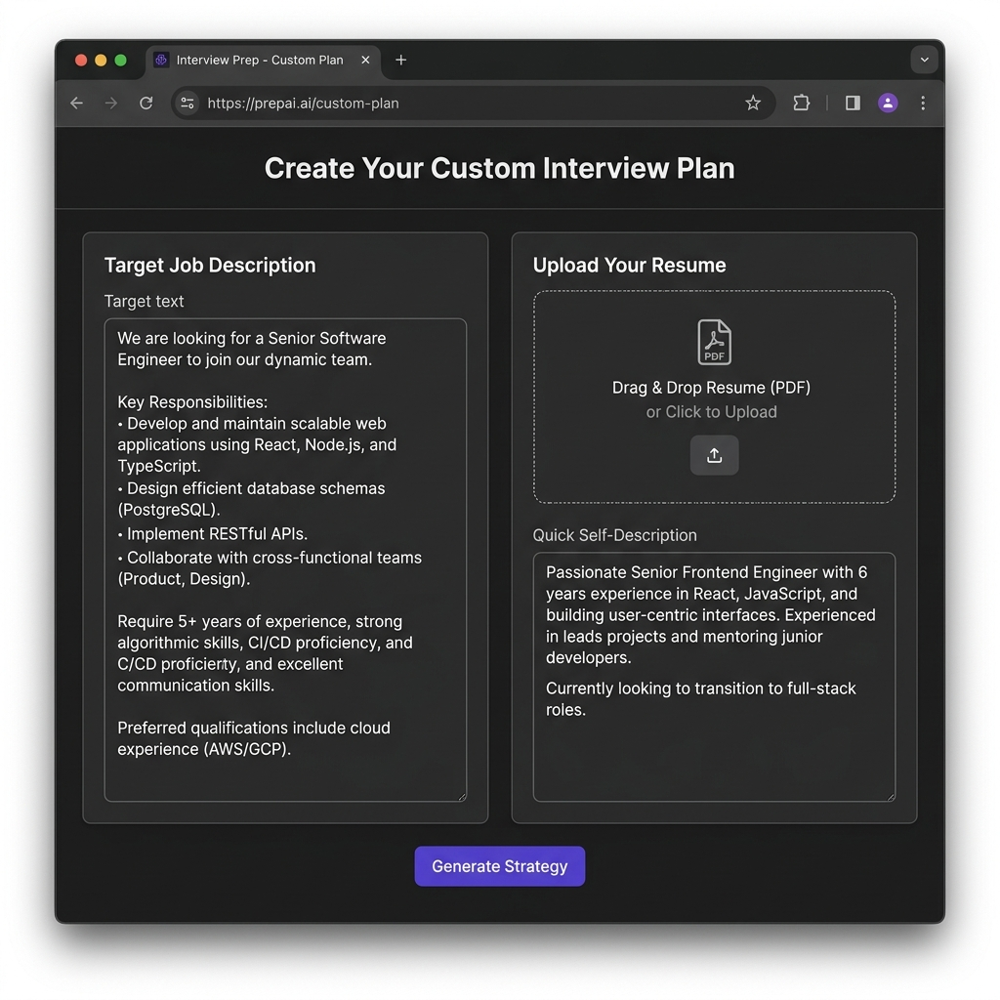
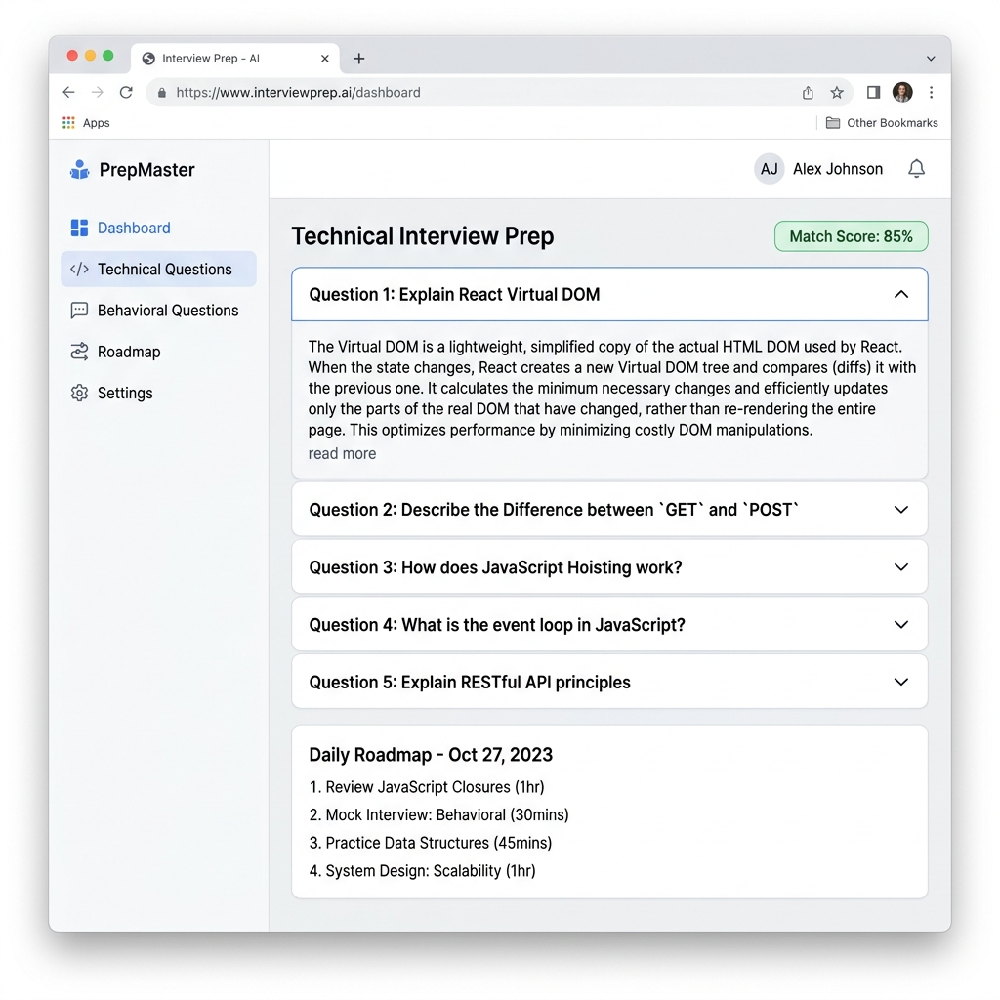

# 🚀 AI-Powered Interview Preparation Platform

An end-to-end full-stack web application designed to help job seekers prepare for targeted technical and behavioral interviews. Powered by **Google Gemini AI**, **Node.js**, **Express**, **MongoDB**, and **React**.

---

## 📸 Application Screenshots

### 1. Home / Plan Generator Screen
Paste target job descriptions, upload your resume (PDF/DOCX), or provide a quick profile summary to generate a customized interview strategy.



---

### 2. Interview Report & Strategy Dashboard
View your role match score, practice curated technical and behavioral questions with model answers, and follow a day-by-day preparation roadmap.



---

## ✨ Key Features

- 🔒 **User Authentication**: Secure JWT-based registration and login system with encrypted password hashing (`bcryptjs`).
- 📄 **Resume Parsing**: Automatically extracts technical skills and qualifications from PDF/DOCX resumes using `pdf-parse` & `multer`.
- 🎯 **Tailored Job Matching**: Calculates a **Match Score (%)** comparing your candidate profile against the target job description.
- ❓ **AI Question Generator**: Generates customized Technical and Behavioral interview questions along with **Interviewer Intent** and **Model Answers**.
- 🗺️ **Personalized Preparation Roadmap**: Produces a structured daily action plan with specific study items and milestones.
- 🖨️ **PDF Exporting**: Converts candidate reports and resumes into formatted PDFs via server-side rendering using `puppeteer`.

---

## 🛠️ Tech Stack & Dependencies

### Frontend
- **Framework**: React 19
- **Build Tool**: Vite 7
- **Routing**: React Router 7
- **Styling**: SCSS / Sass
- **HTTP Client**: Axios

### Backend
- **Runtime & Server**: Node.js & Express 5
- **Database**: MongoDB & Mongoose ORM
- **AI Integration**: `@google/genai` (Google Gemini SDK)
- **Validation**: Zod & `zod-to-json-schema`
- **File Upload & Parsing**: Multer & `pdf-parse`
- **PDF Generator**: Puppeteer
- **Authentication**: JSON Web Token (`jsonwebtoken`) & `bcryptjs`

---

## ⚙️ Environment Variables

Create a `.env` file inside the `Backend/` directory with the following variables:

```env
PORT=5000
MONGO_URI=mongodb://localhost:27017/interview_ai
JWT_SECRET=your_jwt_secret_key_here
GEMINI_API_KEY=your_google_gemini_api_key_here
```

---

## 🚀 Local Installation & Setup

### Prerequisites
- [Node.js](https://nodejs.org/) (v18+)
- [MongoDB](https://www.mongodb.com/) (Running locally or a MongoDB Atlas URI)
- [Google Gemini API Key](https://aistudio.google.com/)

### 1. Clone the Repository
```bash
git clone https://github.com/garvit-07/AI-Powered-Interview-Preparation-Platform.git
cd AI-Powered-Interview-Preparation-Platform
```

### 2. Setup & Start Backend Server
```bash
cd Backend
npm install
npm run dev
```
The backend server will run on `http://localhost:5000`.

### 3. Setup & Start Frontend App
Open a new terminal window:
```bash
cd Frontend
npm install
npm run dev
```
The frontend application will run on `http://localhost:5173`.

---

## 🔌 API Endpoints Summary

### Authentication Routes (`/api/auth`)
| Method | Endpoint | Description | Auth Required |
|---|---|---|---|
| `POST` | `/api/auth/register` | Register a new user | ❌ No |
| `POST` | `/api/auth/login` | Authenticate user & receive JWT | ❌ No |
| `GET` | `/api/auth/logout` | Clear user session cookie | ❌ No |

### Interview & Strategy Routes (`/api/interview`)
| Method | Endpoint | Description | Auth Required |
|---|---|---|---|
| `POST` | `/api/interview/generate` | Upload resume & JD to generate AI plan | 🔒 Yes |
| `GET` | `/api/interview/:id` | Fetch specific interview strategy report | 🔒 Yes |
| `GET` | `/api/interview/history` | List all past interview reports for user | 🔒 Yes |
| `GET` | `/api/interview/:id/resume` | Export generated resume as PDF | 🔒 Yes |

---

## 📁 Repository Directory Structure

```
.
├── assets/
│   ├── home_preview.png
│   └── report_preview.png
├── Backend/
│   ├── server.js
│   ├── package.json
│   └── src/
│       ├── app.js
│       ├── config/
│       │   └── database.js
│       ├── controllers/
│       │   ├── auth.controller.js
│       │   └── interview.controller.js
│       ├── middlewares/
│       │   ├── auth.middleware.js
│       │   └── multer.middleware.js
│       ├── models/
│       ├── routes/
│       └── services/
│           └── ai.service.js
└── Frontend/
    ├── package.json
    ├── vite.config.js
    └── src/
        ├── App.jsx
        ├── app.routes.jsx
        ├── main.jsx
        └── features/
            ├── auth/
            └── interview/
```

---

## 📜 License

This project is licensed under the [ISC License](LICENSE).
